---

### 🙋 Hakkımda

- 🎓 Mehmet Akif Ersoy Üniversitesi'nde **Bilişim Sistemleri ve Teknolojileri** okuyorum.
- ⚙️ **Backend** ve **bulut altyapısı** ilgimi en çok çeken alanlar: API'ler, entegrasyonlar, sunucular, konteynerler.
- 🧭 Projelerimi gerçek bir sorundan yola çıkarak yapıyorum: önce kimin işine yarayacağını, sonra nasıl yapılacağını düşünüyorum.
- 🤖 Yapay zekayı geliştirme sürecimde aktif kullanıyorum. Kararları ben veriyorum, her satırın ne yaptığını bilmeyi hedefliyorum.

---

### 🥖 Öne çıkan proje

**[e-Fatura Süreç Otomasyonu](https://github.com/whywouldnt/e-fatura-surec-otomasyonu)**: Bir aile fırını için geliştirdiğim Telegram botu. El yazısı teslimat defterinin fotoğrafını ya da serbest bir mesajı okuyor, tek onayla resmi e-Fatura / e-Arşiv kesiyor.

| | |
|:--|:--|
| 🧠 **Tasarım ilkesi** | Yapay zeka yalnızca okur; müşteri eşleştirme, KDV ve tutarlar deterministik kodda hesaplanır |
| 🔌 **Entegrasyon** | Veriban SOAP · UBL-TR 2.1 · e-Fatura + e-Arşiv |
| ☁️ **Altyapı** | Azure'da Linux VM · işletme başına izole Docker konteyneri · ~4 $/ay |
| ✅ **Kalite** | 303 otomatik test · GitHub Actions CI · entegratörün test ortamında uçtan uca test |
| 📅 **Durum** | Pilot: ilk gerçek fatura kesimi Aralık 2026 |

Kaynak kodu gerçek bir işletmenin verisiyle çalıştığı için özel depoda; vitrin deposunda mimari ve ayrıntılar var.

---

### 🧰 Teknolojiler

**Kullandıklarım**

**Öğrendiklerim**

---

<b>🇬🇧 In English</b>

 

Hi, I'm **Muhammet Ali Rıza İçen**, an Information Systems & Technologies student at Mehmet Akif Ersoy University (Türkiye), focused on **backend development and cloud infrastructure**.

My main project is a **Telegram bot that turns a bakery's handwritten delivery ledger into official e-invoices**: an LLM reads photos or free-form text, deterministic Python computes every amount and VAT, a human approves with one tap, and invoices go to the integrator over SOAP (UBL-TR 2.1). It runs 24/7 in isolated Docker containers on an Azure Linux VM, backed by 303 automated tests. → [Project showcase](https://github.com/whywouldnt/e-fatura-surec-otomasyonu)

Reach me on [LinkedIn](https://www.linkedin.com/in/ali-r%C4%B1za-i%C3%A7en-184826322/) or by [email](mailto:alirizaicenn@gmail.com).

